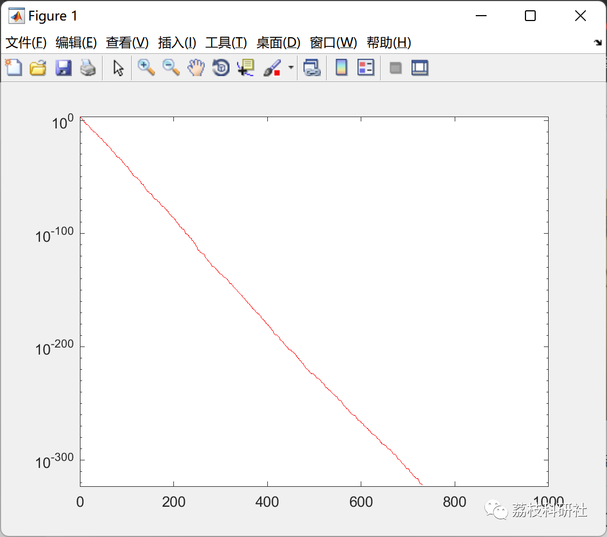
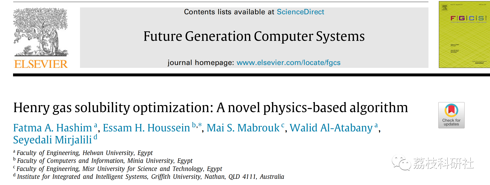

# Improved Henry Gas Solubility Algorithm (Matlab Code Implementation)

💥💥💥💞💞💞 Welcome to this blog❤️❤️❤️💥💥💥
🏆 Bloggers' Advantages: 🌞🌞🌞 The content of the blog strives for rigorous thinking and clear logic to facilitate readers.
⛳️ Mantra: A journey of a thousand miles is begun with a single step.
Litchi Research Society
Code Collection: Power Systems, Intelligent Algorithms and Applications, Neural Network Prediction, Path Planning, Optimized Scheduling, Workshop Scheduling, Image Processing, Signal Processing...
🎁 Special Section Link: ​
🌈🌈🌈🌟🌟🌟 Electrical Code Intelligent Algorithms and Their Applications Path Planning Neural Network Prediction Optimized Scheduling Image Processing Workshop Scheduling Signal Processing Romantic Her
My Thoughts on Mathematical Modeling Complete Code Matters
Directory
💥1 Overview
📚2 Run Results
🎉3 References
🌈4 Matlab Code Implementation and Detailed Articles
💥1 Overview
HGSO mimics the behavior of Henry's Law to solve challenging optimization problems. Henry's Law is a basic gas law that involves the amount of a given gas dissolved in a given volume of liquid at a fixed temperature. HGSO algorithm mimics the clustering behavior of gases to balance exploration and exploitation in the search space and avoid local optima.
Henry's Law
Henry's Law was first proposed by J.W. Henry in 1800, which is a gas law that states the amount of a gas dissolved in a given volume of solvent at a specified temperature or pressure is proportional to its partial pressure above the solvent. In other words, the maximum amount of solute that can be dissolved in a specific amount of solvent at a certain temperature or pressure is called the solubility. HGSO is inspired by Henry's Law behavior.
📚2 Run Results
🎉3 References
🌈4 Matlab Code Implementation and Detailed Articles
Click the article below left bottom [Read Full Article]

## Images

<!-- PAYMENT_BLOCK -->

## Get this dataset

- Payment link (Stripe): [Buy now](https://buy.stripe.com/3cs8yP7sY87d0vu9AB)
- Payment QR code: 

<!-- /PAYMENT_BLOCK -->
